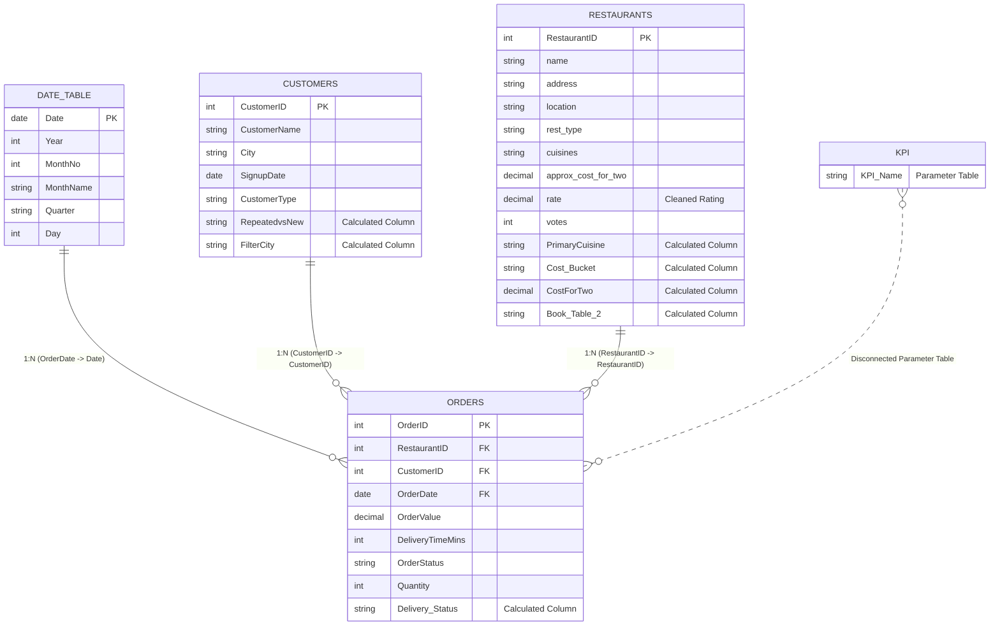

# 🍽️ Restaurant Business Intelligence & Performance Analytics Dashboard

[](https://powerbi.microsoft.com/)
[](https://learn.microsoft.com/en-us/dax/)
[](https://www.microsoft.com/en-us/microsoft-365/excel)
[](#-data-modeling--architecture)
[](#)

An enterprise-grade, end-to-end **Power BI Business Intelligence Solution** designed to analyze restaurant performance, order fulfillment, delivery logistics, and customer behavior across Bangalore (Bengaluru) food service ecosystem. 

Analyzing over **200,000 orders**, **56,250 partner restaurants**, and **20,000 customers** across **2023–2025**, this dashboard equips restaurant aggregators, operations leads, and business executives with actionable intelligence to reduce delivery delays, boost customer retention, and maximize revenue per partner.

---

## 📌 Table of Contents

- [Executive Summary](#-executive-summary)
- [Key Business Metrics](#-key-business-metrics)
- [Dashboard Architecture & Report Pages](#-dashboard-architecture--report-pages)
  - [1. Executive Overview](#1-executive-overview)
  - [2. Restaurant Performance](#2-restaurant-performance)
  - [3. Restaurant Details (Drillthrough)](#3-restaurant-details-drillthrough)
  - [4. Customer Analytics](#4-customer-analytics)
  - [5. Delivery & Operations](#5-delivery--operations)
  - [6. Advanced Insights & NLP Q&A](#6-advanced-insights--nlp-qa)
- [Data Modeling & Architecture](#-data-modeling--architecture)
- [Data Dictionary](#-data-dictionary)
- [DAX Calculations & Business Logic](#-dax-calculations--business-logic)
- [ETL & Data Transformation (Power Query)](#-etl--data-transformation-power-query)
- [Key Strategic Insights & Recommendations](#-key-strategic-insights--recommendations)
- [Repository Structure](#-repository-structure)
- [How to Use & Run](#-how-to-use--run)

---

## 📊 Executive Summary

| Dimension | Metric / Metric Value | Context |
| :--- | :--- | :--- |
| **Gross Merchandise Value (GMV)** | **₹164.91M (~₹165M)** | Cumulative revenue generated across 200,000 orders |
| **Total Orders Fulfilled** | **200,000 (200K)** | Multi-year order volume across Bangalore clusters |
| **Average Order Value (AOV)** | **₹824.57** | Healthy basket size across diverse customer cohorts |
| **Partner Network** | **56,250 Restaurants** | Diverse ecosystem across Budget, Mid-Range, and Premium |
| **Customer Base** | **20,000 Customers** | 14K active ordering customers; 73.34% repeat customer rate |
| **Average Delivery Time** | **44.55 minutes** | End-to-end turnaround time from kitchen to doorstep |
| **Delivery Success Rate** | **80.09% Delivered** | 160.2K delivered; 10.00% cancelled; 9.92% delayed |
| **On-Time Delivery SLA** | **51.84% On-Time / 48.16% Late** | Critical operational bottleneck identified for intervention |

---

## 🎯 Key Business Metrics

```
┌─────────────────────────┐  ┌─────────────────────────┐  ┌─────────────────────────┐  ┌─────────────────────────┐
│      TOTAL REVENUE      │  │      TOTAL ORDERS       │  │     AVG ORDER VALUE     │  │    AVG DELIVERY TIME    │
│         ₹165M           │  │          200K           │  │         ₹824.57         │  │       44.55 Mins        │
└─────────────────────────┘  └─────────────────────────┘  └─────────────────────────┘  └─────────────────────────┘
┌─────────────────────────┐  ┌─────────────────────────┐  ┌─────────────────────────┐  ┌─────────────────────────┐
│    TOTAL RESTAURANTS    │  │     AVERAGE RATING      │  │   REPEAT CUSTOMER RATE  │  │      LATE DELIVERY %    │
│          56K            │  │        3.70 / 5.0       │  │         73.34%          │  │          48.16%         │
└─────────────────────────┘  └─────────────────────────┘  └─────────────────────────┘  └─────────────────────────┘
```

---

## 🖥️ Dashboard Architecture & Report Pages

The solution consists of **6 dedicated report pages**, engineered with a cohesive design system, unified color typography, dynamic slicers, drillthrough filters, and natural language analytics.

---

### 1. Executive Overview

> **Target Audience:** C-Suite, VP of Operations, Regional Business Directors  
> **Core Purpose:** High-level executive pulse check monitoring revenue growth, order volume, fulfillment health, top vendor contribution, and geographic distribution.


#### Visual Elements & Breakdown:
- **KPI Summary Cards:** Total Revenue (**₹165M**), Total Orders (**200K**), Avg Order Value (**₹824.57**), and Avg Delivery Time (**44.55 mins**).
- **Order Status Breakdown (Donut Chart):** Shows delivery reliability:
  - **Delivered:** 155K–160.2K (**80.09%**)
  - **Cancelled:** 19K–20.0K (**10.00%**)
  - **Delayed:** 19K–19.8K (**9.92%**)
- **Top 10 Restaurants Leaderboard (Table):** Tracks revenue drivers, volume, and quality ratings:
  1. *Cafe Coffee Day:* ₹276,616 | 325 orders | 3.26 rating
  2. *Onesta:* ₹269,971 | 327 orders | 4.41 rating
  3. *Empire Restaurant:* ₹222,140 | 262 orders | 4.03 rating
  4. *Just Bake:* ₹213,038 | 277 orders | 3.41 rating
  5. *Five Star Chicken:* ₹207,255 | 253 orders | 3.43 rating
  6. *Baskin Robbins:* ₹199,324 | 244 orders | 3.57 rating
  7. *Petoo:* ₹197,920 | 234 orders | 3.83 rating
  8. *Chef Baker's:* ₹192,111 | 238 orders | 3.59 rating
  9. *Pizza Hut:* ₹189,322 | 223 orders | 3.38 rating
  10. *Kanti Sweets:* ₹189,781 | 237 orders | 3.90 rating
- **Revenue by City (Clustered Bar Chart):** Pinpoints highest revenue generating commercial hubs in Bangalore (top locality contributing over ₹15.4M).
- **Order Trend & Revenue Trend (Dual Line Charts):** Multi-year monthly time series displaying steady volume trends with seasonality peaks and dips.

---

### 2. Restaurant Performance

> **Target Audience:** Partner Relationship Managers, Merchant Acquisition Teams  
> **Core Purpose:** Evaluate partner quality, pricing tiers, cuisine popularity, and the statistical distribution of restaurant ratings.


#### Visual Elements & Breakdown:
- **Partner KPI Cards:** Total Restaurants (**56K**), Average Rating (**3.70 / 5.0**), Average Votes (**261**), and Revenue Per Restaurant (**₹2.93K**).
- **Cost Tier Slicer:** Interactive category filter (`Budget` | `Mid Range` | `Premium`).
- **Cost Bucket vs Orders (Pie Chart):**
  - **Budget (<= ₹500):** 77K orders (**57.61%**) — primary volume driver.
  - **Mid Range (₹501–₹1000):** 43K orders (**31.93%**) — stable margin builder.
  - **Premium (> ₹1000):** 14K orders (**10.46%**) — high basket size segment.
- **Orders by Cuisine (Clustered Bar Chart):** Identifies consumer culinary demand:
  - *North Indian* dominates with **44K orders**, followed by *Chinese* (**18K**), *South Indian* (**15K**), *Fast Food* (**11K**), and *Biryani* (**11K**).
- **Revenue by Top 10 Restaurants (Column Chart):** Direct comparison of top revenue-generating brands.
- **Average Rating by Cuisine (Column Chart):** Highlights cuisine categories maintaining the highest customer satisfaction scores (ranging from 3.5 to 4.0).
- **Restaurant by Rating Distribution (Scatter Plot):** Displays a normal bell curve centered between 3.6 and 3.8 rating, confirming realistic customer review patterns.

---

### 3. Restaurant Details (Drillthrough Page)

> **Target Audience:** Merchant Success Associates, Vendor Operations  
> **Core Purpose:** Partner-specific deep dive accessed via right-click drillthrough on any restaurant name across the report (pre-filtered to *Empire Restaurant* as an example).


#### Visual Elements & Breakdown:
- **Interactive Drillthrough Navigation:** Top-left return button (`←`) enables smooth navigation back to parent summary pages.
- **Dynamic Header:** Displays the filtered partner name (*e.g., Empire Restaurant*).
- **Partner Scorecard KPIs:**
  - **Total Revenue:** ₹222K
  - **Average Delivery Time:** 45.05 mins
  - **Average Votes:** 3,237 votes (high brand engagement)
  - **Average Rating:** 4.03 / 5.0
  - **Total Orders:** 262 orders
- **Orders by Customer Type (Bar Chart):** Customer composition breakdown:
  - *Returning Customers:* 133 orders (50.8%)
  - *New Customers:* 105 orders (40.1%)
  - *Premium Customers:* 24 orders (9.1%)
- **Delivery Status Breakdown (Donut Chart):** Pinpoints vendor-level dispatch SLA compliance (**49.6% On Time vs 50.4% Late**).
- **Revenue & Order Longitudinal Trends (Dual Line Charts):** Temporal demand fluctuation specific to the selected partner.

---

### 4. Customer Analytics

> **Target Audience:** Growth Marketing, Customer Retention Teams, CRM Analysts  
> **Core Purpose:** Understand user acquisition, repeat order loyalty, table booking behavior, and customer lifetime value across city zones.


#### Visual Elements & Breakdown:
- **Customer KPI Cards:** Total Customers (**14K active / 20K total**), Repeat Customers (**10K**), Repeat Customer Rate (**73.34%**), Orders Per Customer (**~2.0**).
- **Table Booking Slicer:** Cross-filters metrics based on table booking availability (`No` / `Yes`).
- **New vs. Repeat Customers (Donut Chart):**
  - **Repeated Customers:** 7K+ orders (**50.34%**)
  - **New Customers:** 7K orders (**49.66%**)
- **Orders by Customer Type (Clustered Bar Chart):**
  - *Returning:* **11.5K orders**
  - *New:* **9.4K orders**
  - *Premium:* **2.3K orders**
- **Top 10 High-Value Customers (Table):** Tracks top spenders by `CustomerID`, `Total Revenue`, `Total Orders`, and their primary `FilterCity` (*e.g., Brigade Road, BTM, Electronic City, HSR, Indiranagar, Koramangala, Malleshwaram, Rajajinagar, Richmond Road, Varthur*).
- **Signup Trend vs Order Trend (Dual Line Charts):** Tracks customer onboarding trajectories against actual purchase frequency across quarters.

---

### 5. Delivery & Operations

> **Target Audience:** Fleet Logistics Directors, City Dispatch Managers  
> **Core Purpose:** Monitor delivery speed, identify logistics bottlenecks by geographic cluster, and analyze root causes of order cancellations and delays.


#### Visual Elements & Breakdown:
- **Temporal Filter Slicer:** Multi-year selector (`2023`, `2024`, `2025`).
- **Operations KPI Cards:**
  - **Avg Delivery Time:** 44.55 minutes
  - **Late Orders %:** 48.16%
  - **Late Delivery %:** 48.16%
  - **Cancelled Orders:** 5,367 orders (filtered view)
- **Delivery Time by City (Horizontal Bar Chart):** Ranks Bangalore localities by delivery latency, pinpointing delivery bottlenecks in distant suburbs where delivery times surge up to **68 minutes**, compared to central hubs at **45 minutes**.
- **Delivery Status Breakdown (Donut Chart):**
  - **On Time (<= 45 mins):** 27K orders (**51.9%**)
  - **Late (> 45 mins):** 25K orders (**48.1%**)
- **Order City Matrix (Pivot Table):** Detailed multi-dimensional breakdown cross-tabulating `Cancelled`, `Delayed`, and `Delivered` orders per locality.
- **Cancellation by City (Horizontal Bar Chart):** Isolates localities experiencing high cancellation volumes (top zone registering **510 cancellations**).

---

### 6. Advanced Insights & NLP Q&A

> **Target Audience:** Business Intelligence Analysts, Strategy Consultants  
> **Core Purpose:** Dynamic metric parameter switching, multi-variable correlation analysis, and self-service ad-hoc querying via Natural Language Processing (NLP).


#### Visual Elements & Breakdown:
- **Dynamic Metric Selection Slicer (KPI Parameter):** Seamless button bar allowing users to switch the primary evaluation metric on the fly:
  - `Avg Delivery Time`
  - `Orders`
  - `Avg Order Value`
  - `Revenue`
- **Dynamic Trend Line Chart:** Automatically updates axes, trendlines, and data labels based on the user's active KPI selection (configured in screenshot to show `Avg Delivery Time` fluctuating between **44.16 and 44.91 minutes**).
- **Multi-Dimensional Scatter Plot ("Revenue vs Rating vs Cost"):**
  - **X-Axis:** `rate` (Restaurant customer rating)
  - **Y-Axis:** `Selected KPI Value` (dynamically adapts with slicer)
  - **Bubble Size:** `CostForTwo` (Average meal price for two people)
  - **Color Legend:** `Cost Bucket` (Budget / Mid Range / Premium)
- **Power BI Q&A Natural Language Processing (NLP):** Interactive conversational search bar allowing non-technical stakeholders to ask questions in plain English:
  - *"what is the total orders by filter city"*
  - *"what is the total revenue by filter city"*
  - *"what is the total orders by customer type"*
  - *"top locations by avg order value"*
  - *"what is the total revenue by order status"*

---

## 🏗️ Data Modeling & Architecture

The analytical backend is built on a robust **Star Schema** with normalized dimensions surrounding a central high-volume fact table, supplemented by a disconnected parameter table for dynamic DAX switching.



### Relationship Design Principles:
1. **One-to-Many (`1:*`) Cardinality:** Single directional filtering flows from Dimension tables (`Customers`, `Restaurants`, `DateTable`) into the Fact table (`Orders`), preventing filter context ambiguity and circular references.
2. **Disconnected Parameter Model:** The `KPI` table operates independently of data relationships and relies on DAX `SWITCH()` + `SELECTEDVALUE()` logic to dynamically modify visual measures.
3. **Optimized Data Types:** Clean numeric values for `rate` and `CostForTwo` replace raw text strings to enable rapid VertiPaq engine aggregation.

---

## 📖 Data Dictionary

<details>
<summary><strong>Click to expand full Data Dictionary (5 Tables)</strong></summary>

### 1. `Orders` (Fact Table - 200,000 Rows)
| Column Name | Data Type | Description |
| :--- | :--- | :--- |
| `OrderID` | Integer | Unique identifier for each order (Primary Key) |
| `RestaurantID` | Integer | Foreign Key referencing `Restaurants` |
| `CustomerID` | Integer | Foreign Key referencing `Customers` |
| `OrderDate` | Date / DateTime | Date order was placed (Foreign Key to `DateTable`) |
| `OrderValue` | Decimal (Currency) | Net order transaction value in INR (₹150 to ₹1,499) |
| `DeliveryTimeMins` | Integer | Elapsed delivery turnaround time in minutes (20 to 69 mins) |
| `OrderStatus` | Text | Fulfillment outcome (`Delivered`, `Delayed`, `Cancelled`) |
| `Quantity` | Integer | Count of food items included in the order |
| *`Delivery Status`* | Text (Calculated) | Classification: `On Time` (<= 45 mins) vs `Late` (> 45 mins) |

### 2. `Restaurants` (Dimension Table - 56,250 Rows)
| Column Name | Data Type | Description |
| :--- | :--- | :--- |
| `RestaurantID` | Integer | Unique identifier for partner restaurant (Primary Key) |
| `name` | Text | Registered business / brand name |
| `address` | Text | Full physical address |
| `location` | Text | Micro-neighborhood / locality in Bangalore |
| `rest_type` | Text | Dining style (*Casual Dining, Cafe, Quick Bites, Bakery*) |
| `dish_liked` | Text | Popular customer-favorite items |
| `cuisines` | Text | Comma-separated list of served cuisines |
| `approx_cost(for two people)` | Text | Raw string cost representation (*e.g., "800"*) |
| `online_order` | Text | Online ordering enabled (`Yes`/`No`) |
| `book_table` | Text | Table reservation supported (`Yes`/`No`) |
| *`rate`* | Decimal (Calculated) | Clean numeric score extracted from raw "X/5" format (1.8 to 4.9) |
| `votes` | Integer | Cumulative user reviews and ratings received |
| *`PrimaryCuisine`* | Text (Calculated) | Extracted first cuisine listed for clean categorical grouping |
| *`CostForTwo`* | Decimal (Calculated) | Parsed numeric cost for two diners (₹40 to ₹6,000) |
| *`Cost Bucket`* | Text (Calculated) | Spend tier: `Budget` (<= ₹500), `Mid Range` (₹501–₹1000), `Premium` (> ₹1000) |
| *`Book_Table 2`* | Text (Calculated) | Standardized clean table booking flag (`Yes`/`No`) |

### 3. `Customers` (Dimension Table - 20,000 Rows)
| Column Name | Data Type | Description |
| :--- | :--- | :--- |
| `CustomerID` | Integer | Unique identifier for the customer (Primary Key) |
| `CustomerName` | Text | Masked user account name |
| `City` | Text | Registered customer locality / neighborhood |
| `SignupDate` | Date | Account creation date |
| `CustomerType` | Text | Segment category (`New`, `Returning`, `Premium`) |
| *`RepeatedvsNew`* | Text (Calculated) | Order frequency grouping (`Repeated` vs `New`) |
| *`FilterCity`* | Text (Calculated) | Cleansed geographic locality name |

### 4. `DateTable` (Dimension Table - 1,000 Rows)
| Column Name | Data Type | Description |
| :--- | :--- | :--- |
| `Date` | Date | Calendar day (2023-01-01 through 2025-09-26) |
| `Year` | Integer | Four-digit calendar year (`2023`, `2024`, `2025`) |
| `MonthNo` | Integer | Month index (1 to 12) |
| `MonthName` | Text | Three-letter month abbreviation (`Jan`, `Feb`, etc.) |
| `Quarter` | Text | Calendar quarter (`Q1`, `Q2`, `Q3`, `Q4`) |
| `Day` | Integer | Day of the month (1 to 31) |

### 5. `KPI` (Parameter Table)
| Column Name | Data Type | Description |
| :--- | :--- | :--- |
| `KPI Name` | Text | Selector values: `Avg Delivery Time`, `Orders`, `Avg Order Value`, `Revenue` |

</details>

---

## 🧮 DAX Calculations & Business Logic

All metrics are consolidated into dedicated DAX measures following best practices:

```dax
// ==========================================
// 1. REVENUE & ORDER VOLUME MEASURES
// ==========================================

Total Revenue = 
SUM(Orders[OrderValue])

Total Orders = 
COUNTROWS(Orders)

Avg Order Value = 
DIVIDE([Total Revenue], [Total Orders], 0)

Quantity Sold = 
SUM(Orders[Quantity])


// ==========================================
// 2. PARTNER & QUALITY METRICS
// ==========================================

Total Restaurants = 
DISTINCTCOUNT(Restaurants[RestaurantID])

Avg Rating = 
AVERAGE(Restaurants[rate])

Avg Votes = 
AVERAGE(Restaurants[votes])

Revenue per Restaurant = 
DIVIDE([Total Revenue], [Total Restaurants], 0)


// ==========================================
// 3. CUSTOMER LOYALTY & RETENTION MEASURES
// ==========================================

Total Customers = 
DISTINCTCOUNT(Orders[CustomerID])

Repeat Customers = 
CALCULATE(
    DISTINCTCOUNT(Orders[CustomerID]),
    Customers[RepeatedvsNew] = "Repeated"
)

Repeat Customer % = 
DIVIDE([Repeat Customers], [Total Customers], 0)

Orders Per Customer = 
DIVIDE([Total Orders], [Total Customers], 0)


// ==========================================
// 4. DELIVERY & OPERATIONAL PERFORMANCE MEASURES
// ==========================================

Avg Delivery Time = 
AVERAGE(Orders[DeliveryTimeMins])

Late Orders = 
CALCULATE(
    [Total Orders],
    Orders[Delivery Status] = "Late"
)

Late Delivery % = 
DIVIDE([Late Orders], [Total Orders], 0)

Cancelled Orders = 
CALCULATE(
    [Total Orders],
    Orders[OrderStatus] = "Cancelled"
)

Cancellation Rate = 
DIVIDE([Cancelled Orders], [Total Orders], 0)


// ==========================================
// 5. DYNAMIC PARAMETER SWITCHING MEASURE
// ==========================================

Selected KPI Value = 
SWITCH(
    SELECTEDVALUE('KPI'[KPI Name]),
    "Avg Delivery Time", [Avg Delivery Time],
    "Orders", [Total Orders],
    "Avg Order Value", [Avg Order Value],
    "Revenue", [Total Revenue],
    [Total Revenue]
)
```

---

## 🔄 ETL & Data Transformation (Power Query)

During ingestion from `dataset.xlsx`, multiple data hygiene and feature engineering transformations were implemented:

1. **Rating Text Extraction:** Raw restaurant ratings (*e.g., "4.1/5"*, *"NEW"*, *"- "*) were parsed to strip non-numeric substrings and cast into a clean Decimal (`4.1`).
2. **Cost Normalization:** Stripped thousands separators from `approx_cost(for two people)` (*e.g., "1,200" → 1200*) and created the three-tier `Cost Bucket` conditional column.
3. **Primary Cuisine Extraction:** Used text extraction before the first delimiter (`,`) to isolate primary cuisine tags (*e.g., "North Indian, Chinese" → "North Indian"*), preventing visual clutter.
4. **Delivery SLA Thresholding:** Evaluated `DeliveryTimeMins` against a 45-minute operational SLA benchmark:
   - `DeliveryTimeMins <= 45` ➔ **"On Time"**
   - `DeliveryTimeMins > 45` ➔ **"Late"**
5. **Date Table Auto-Generation:** Formed a continuous date sequence spanning `2023-01-01` through `2025-09-26` with fiscal quarters, month numbers, and sorting keys.

---

## 💡 Key Strategic Insights & Recommendations

```
┌────────────────────────────────────────────────────────────────────────────────────────────────┐
│                                 STRATEGIC BUSINESS TAKEAWAYS                                   │
├────────────────────────────────┬───────────────────────────────┬───────────────────────────────┤
│ 1. Delivery SLA Risk           │ 2. Budget Volume Engine       │ 3. Strong Repeat Retention    │
│ 48.16% of deliveries exceed 45 │ Budget restaurants generate   │ 73.34% repeat customer rate   │
│ mins, rising to 68 mins in     │ 57.61% of all orders, while   │ demonstrates strong product-  │
│ outlying suburbs.              │ premium drives higher margin. │ market fit and loyalty.       │
└────────────────────────────────┴───────────────────────────────┴───────────────────────────────┘
```

1. **Optimize Suburban Logistics Hubs:** Delivery durations spike dramatically in outlying zones (exceeding 60–68 minutes) and directly correlate with high cancellation rates (up to 510 cancellations per zone). Introducing dark kitchens or micro-dispatch hubs in these high-friction clusters will compress transit times.
2. **Address Delivery SLA Degradation:** With **48.16% of orders classified as late**, operational intervention is needed at partner kitchens during peak hours (staggering order intake and pre-assigning delivery partners prior to food packaging).
3. **Capitalize on Cuisine Concentration:** North Indian cuisine accounts for **44K orders**, more than double any other category. Cross-promotional bundles pairing North Indian meals with high-margin items (Beverages, Desserts) will increase Average Order Value (AOV).
4. **Targeted Premium Tier Upselling:** Premium customers account for only **2.3K orders** (compared to 11.5K returning orders). Launching an invite-only loyalty tier offering priority dispatch and zero delivery fees can unlock significant revenue growth.

---

## 📂 Repository Structure

```
PowerBi/
│
├── Restaurant.pbix              # Master Power BI report (PBIR format with 6 pages)
│
├── README.MD                    # Project documentation & visual walkthrough
│
├── dataset/
│   └── dataset.xlsx             # Source Excel database (Restaurants, Customers, Orders, DateTable)
│
└── Images/                      # High-resolution dashboard screenshots
    ├── Executive Overview.png
    ├── Restaurant Performance.png
    ├── Restaurant Details.png
    ├── Customer Analysis.png
    ├── Delivery and Operations.png
    └── Advanced Insights.png
```

---

## 🚀 How to Use & Run

### Prerequisites
- [Power BI Desktop](https://powerbi.microsoft.com/desktop/) (Version October 2023 or newer recommended)
- Microsoft Excel (to inspect `dataset/dataset.xlsx`)

### Steps to Open the Report
1. **Clone the Repository:**
   ```bash
   git clone https://github.com/your-username/restaurant-powerbi-analytics.git
   cd restaurant-powerbi-analytics
   ```
2. **Open the Report:**
   - Double-click `Restaurant.pbix` to launch the report in **Power BI Desktop**.
3. **Change Data Source Path (if prompted):**
   - In Power BI Desktop, click **Transform Data** > **Data source settings**.
   - Select `dataset.xlsx` and click **Change Source...**.
   - Browse to your local path: `<clone-directory>/dataset/dataset.xlsx` and click **Apply Changes**.
4. **Explore the Report:**
   - Use the bottom page tab navigation or test the **Drillthrough** feature by right-clicking on any restaurant in *Executive Overview* or *Restaurant Performance* and selecting **Drill through ➔ Restaurant Details**.
   - Interact with the **Dynamic KPI Buttons** on the *Advanced Insights* page.

---

## 👨‍💻 Author & Contributions

- **Project:** Restaurant Business Intelligence & Analytics Dashboard
- **Tools:** Microsoft Power BI, DAX, Power Query M, Microsoft Excel
- **Contributions:** Contributions, issues, and feature suggestions are welcome! Feel free to open an issue or submit a pull request.

---

<p align="center">
  ⭐ If you found this dashboard project helpful or insightful, please consider starring this repository!
</p>

